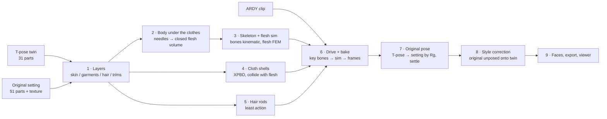

# Bottom-up figure from the T-pose twin

> [!abstract] Goal
> Build the figure from the **T-pose twin**, where every surface is visible. Give it a body with real flesh, a full clothes system and hair. **NVIDIA ARDY** drives the key bones, and a **physics engine** works out the rest, **baked offline** into clips the hologram viewer plays. The same simulated figure then reproduces the **original setting's pose** and is reshaped onto the **original's surfaces**, so no style difference is left.

Why bottom-up: carrying the rig onto the original-pose mesh kept running into hidden or guessed geometry. Hands sit in pockets, and fingers are bent around a scrunchie, so the fit had to guess them. The twin has every surface, so the body comes from it, and the original only adds a correction on top.

Related: [[figure-tripo-direction]] · [[text-to-motion-findings]] · [[figure-hair-merge-least-action]] · [[figure-no-hardcoding]] · [[figure-hologram-look]]

---

## What we already have

| Piece | Where | State |
|---|---|---|
| T-pose twin, 31 Tripo parts, untextured | `E:\figures\rikka\tripo\tpose_tripo.glb` · rigging copy `transfer\twin_in.glb` | ✅ |
| Twin rig: Make-It-Animatable, 52 Mixamo bones and weights | `transfer\twin_rig.npz` | ✅ |
| Original setting model, 51 parts, textured | `tripo_parts_orig.glb` · `transfer\orig.npz` | ✅ |
| The bend from the twin's T-pose to the setting pose (per-bone world turns `Rg`, shape-only fit) | `transfer\ab_free.npz` | ✅ surface miss 4.6 mm median |
| Twin ↔ original part pairing | `ab_free.npz:pair` | ✅ |
| ARDY text-to-motion: CPU encoder with a cache, GPU motion model | `pipeline/ardy_run.py` · env `E:\splat\.venv-ardy` | ✅ 6 s clip ≈ 4 s |
| ARDY → Mixamo rotation transfer: rotations relative to its T-pose; hands and fingers excluded | scratchpad `retarget_ardy.py` | ✅ proven |

Twin parts, read off its own weights:
- **0** head + all hair, one piece
- **1/2** cardigan halves
- **3/4** legs
- **5/6** shoes
- **7** scrunchie
- **8** collar and bow
- **9** face
- **10/12** socks
- **11, 14, 15, 19–22, 26, 28, 29** hands and fingers
- **13** skirt front
- **16/17** pocket flaps
- small trims

---

## Pipeline

### Stage 1 · Layers
Label every point of the twin as one of: **hair**, **skin**, **garment**, **trim** or **face organ**. The labels come from the **twin's own Tripo parts**, one layer per part, with no help from the original (user, 2026-11-18). Hair is its own piece, separate from the face.

> [!note] Tried and dropped
> Labels from the original's texture through the part pairing don't work. Pale anime skin and the white cardigan land in one colour class under every choice of class count. CLIPSeg on renders of the original misses the face under the fringe and the hands in pockets. It also makes the twin depend on the original, which is backwards.

| Layer | Twin parts |
|---|---|
| hair | 0 |
| skin | 3, 4 legs · 9 face/head · 11 left hand + forearm · 14, 15, 20 right hand + wrist · 19, 22, 26, 28, 29 fingers |
| garment | 1, 2 cardigan halves · 13 skirt · 8 shirt collar + bow · 10, 12 socks · 5, 6 shoes |
| trim | 7 scrunchie · 16, 17 pocket flaps · 18, 21, 24, 27, 30 buttons / placket |
| organ | 23, 25 eyes |

- **Output:** `transfer\layers\twin_layers.npz`, check render `transfer\layers\twin_layers.jpg`. Script: scratchpad `twin_layers.py`.
- **Check:** every point labelled ✅. The table is confirmed by the user.

### Stage 2 · Body under the clothes

> [!info] Changed 2026-11-18: a real body model instead of needles
> The twin's cardigan is a single zero-thickness sheet with nothing inside: no torso, no upper arms. ARDY ships a closed standard **SOMA body** (18k points) skinned to the same 77-joint skeleton ARDY animates (`ardy/assets/skeletons/somaskel77/skin_standard.npz`, Apache-2.0 repo).
> - **Stretch:** bone by bone onto the twin's skeleton (`soma_stretch.py`).
> - **Fit:** onto the visible skin and inside the clothes (`body_fit.py`):
>   - skin by mutual nearest points;
>   - "inside" measured away from the body's own bone, since Tripo's normals are only 75% consistent;
>   - shape by keeping edge vectors.
> - **First pass:** watertight. 210 of 18k points outside a garment, by at most 6 mm. Twin skin covered to a 3.2 mm median.
> - **Defects:** pointed skull and crumpled face; a step at the thigh tops where the twin's leg skin ends; a dent at the shoulder; dark (inverted) heels.
>
> The original needle plan below is kept for reference; the needles become the bones and muscles inside this body in stage 3.
Tripo gives no skin under the cardigan or skirt. Grow the body from the **needles**: one rounded segment per bone, sized by the data.
- Where skin is visible, the segment radius fits the skin.
- Under a garment, the radius is the largest that stays inside the garment's inner surface, minus the cloth's own thickness. The thickness is measured from the garment shell.

The needle union is meshed into one closed flesh surface (smooth union, then remesh), and the visible skin is stitched onto it.
- **Output:** `body_rest.ply`, a closed body in T-pose.
- **Check:**
  - watertight;
  - no garment point inside the body;
  - visible skin unchanged (≤ 0.5 mm).

### Stage 3 · Skeleton + flesh

> [!success] First working run (2026-11-18)
> - **Driving:** ARDY drives the stage-2 SOMA body directly (`soma_drive.py`). Each bone's turn is measured from ARDY's T-pose, not the mesh's A-pose bind.
> - **Mesh:** the body is tetrahedralised by **fTetWild** (`pytetwild`, MPL-2.0; `body_tetwild.py`). Tet edge = half the median flesh thickness. 117,639 tets, worst quality 0.23. The body's own skin is embedded in them.
> - **Solver:** **NVIDIA Newton 1.8 VBD**, neo-Hookean, E 30 kPa, ν 0.45 (`newton_flesh.py`, env `E:\splat\.venv-sim`). Pins are nodes nearer a bone than the skin.
> - **Wave clip, 6 s:** stable throughout; volume 98.7–99.4%; at most 20 tets inverted; 464 s on the GTX 1650.
> - **Skin vs skinning-only:** the body is 2 mm off on average (99th percentile 12.5 mm).
> - **Hands:** smear up to 15 cm. Fingers are thinner than the tets and are extrapolated. Fix: hands and fingers ride the skeleton.
> - **Dropped:** a hand-written XPBD solver collapsed 40% of tets, and hand-made Delaunay tets were slivers. See [[existing-solutions-first]].
- **Flesh:** the closed body becomes a **tetrahedral volume** (fTetWild). Inner tets near a bone are pinned to it, so the bone pulls the flesh. The rest is **neo-Hookean FEM**.
- **Muscles:** they come later, as stiffer fibre bundles along the needles.
- **Engine:** **NVIDIA Warp** (Apache-2.0, CUDA, runs on the GTX 1650), with Newton on top where it fits.
- **Check:** an ARDY walk with bones only vs with flesh. The flesh follows, with no inverted tets, and joints keep their volume.

### Stage 4 · Cloth
Each garment becomes a **cloth shell**: **XPBD** stretch and bend, colliding with the flesh and the other garments.
- **Pins:** where a garment holds on (waistband, collar, cuffs, sock tops), found as the garment edge loops lying closest to the body.
- **Layer order:** shirt → cardigan; socks → shoes. It comes from rest-pose nesting: which surface lies inside which.
- **Check:** the walk and sit clips with no cloth passing through the body, and the cardigan hanging open the way it does at rest.

### Stage 5 · Hair
The twin's hair is one piece with the head, so the hair locks come from the original's ~15 hair parts, mapped onto the twin through the pairing. Each lock becomes **elastic rods** minimising one action ([[figure-hair-merge-least-action]]), rooted on the scalp and colliding with the head and shoulders.
- **Check:** the wave and turn clips with the hair swinging, no rods through the head, and the rest shape unchanged.

### Stage 6 · Drive and bake
1. ARDY clip → the twin's skeleton. The T-pose rest matches ARDY's T-pose, so it's a direct rotation copy, with no `Rg`. Hands keep their rest pose until ARDY hands are mapped.
2. Bones are kinematic. Flesh, cloth and hair are simulated at a substep rate the solver needs, chosen by its own convergence, not by hand.
3. **Bake** each frame's points. The format is decided at this stage: a point cache per clip, quantised, for the three.js hologram viewer.
- **Check:** clip plays in the viewer; GPU memory under 4 GB; the bake time is logged.

### Stage 7 · The original's pose
Drive the twin from T-pose into the setting pose with the fit's turns `Rg`, slowly, and let flesh and cloth settle.
- **Output:** the twin standing in the original's pose, with physical cloth.
- **Check:** the settled surface against the original: median miss, per layer.

### Stage 8 · Style correction

> [!success] First pass (2026-11-18), done before stages 4–7 at the user's request
> - **Register:** the bent twin goes onto the original by **non-rigid ICP** (Amberg 2007, `trimesh.registration.nricp_amberg`, its default steps; `style_nricp.py`).
>   - Miss 95th percentile 13.4 → 6.3 mm.
>   - The correction is carried back to T-pose by each point's own turn: median 3.9 mm, 99% 2 cm.
> - **Texture:** each full-detail twin point takes the colour of the original point it lands on (`twin_corrected_nr.npz`, `twin_nr_tex.ply`). Face, eyes, bow, stripes, socks and scrunchie come out right.
> - **Issues:**
>   - the back of the hair changed most and looks chopped, with white blotches;
>   - orange from the scrunchie bleeds onto the right hand's fingers (a hand ↔ scrunchie pairing);
>   - grey smudges at the cardigan hem.
> - **First try dropped:** a per-point gap correction trusted only short matches (Otsu), so it ignored the real style differences.
>
> [!important] Method from now on: texture carving (user, 2026-11-18)
> Nearest-point registration doesn't know what it matches; that's why the hair got chopped and the scrunchie colour bled. Instead:
> 1. **Boundaries:** detect every abrupt change on the original's textured surface.
>    - Colour and texture jumps: per-point Lab gradient over the surface, split by Otsu.
>    - Geometry gaps: Tripo part seams, creases, depth jumps in multi-view renders.
>    - These boundaries are the uncarved features.
> 2. **Labels:** name each region from a prepared semantic list, using either a classifier (Jev or a work model) or a general open-vocabulary detector or segmenter (e.g. SAM 2 regions + OWLv2 / Grounding DINO).
>    - The list: hair, face, eye white, iris, pupil, eyelash, brow, nose, mouth, lips, ear, neck, hand, finger, nail, sleeve, cuff, collar, bow, button, pocket, cardigan, skirt, sock, shoe, scrunchie.
>    - Labels are made on renders and carried back to points (as `views_vis.py` does).
> 3. **Organs:** match each label to what the skeleton provides: SOMA bones and finger segments; FLAME eyes, pupils, nose and mouth contours; our eye spheres.
> 4. **Coarse to fine,** each level a landmark-constrained registration (nricp takes landmarks):
>    1. big bones, angles and proportions;
>    2. skull;
>    3. fingers, and eyeball/pupil direction;
>    4. nose and mouth manifolds.
>
> **Later — face and hands:** keep SOMA for body and fingers; add FLAME 2023 Open (CC-BY-4.0) for jaw, eyeballs and expressions. There's no ARDY-like text driver for expressions or finger actions yet (an open gap).
1. **Unpose the original** into T-pose through the same rig (inverse skinning by `Rg`).
2. Each visible original point lands next to its twin point. The gap is the style difference.
3. That gap becomes a **rest-shape correction** on each layer: body, garments, hair, face.
   - Only where the original is trustworthy: its reach is short (split by Otsu, as in `carry_weights.py`).
   - The rest is filled smoothly across the surface (harmonic), so hidden parts (hands, armpits, the back of the hair) keep the twin's shape.
4. Rerun stage 7 with the corrected rest shapes. **Judge loop:** the settled pose against the original, until the miss stops falling.
- **Check:** the setting pose matches the original to within its own fit noise. The head and face proportions of the original are kept: compare face landmarks against the setting picture.

### Stage 9 · Faces and export
Carved eyes, brows and mouth on the corrected head ([[figure-organ-rendering]]), the jaw bone, and export to the viewer, with the triangle-wireframe hologram look.

---

## Decisions

- [x] Physics **baked offline**, not live in the browser (user, 2026-11-18)
- [x] The twin is the base and the original is a correction (user, 2026-11-18)
- [ ] Bake format for the viewer (point cache vs. bones + correctives) → at stage 6
- [ ] Muscles: fibre bundles now or after flesh works → after stage 3

## Risks

> [!warning]
> - **4 GB GPU:** FEM + cloth + rods on ~100k points may not fit. Fallbacks: coarser simulation meshes driving the full-detail surface, or simulating layers one after another.
> - **Body under the clothes is invented:** stage 2's needles are the only source. They are checked against the garments, never against a real body.
> - **Cloth starting tangled:** Tripo garments touch and cross the body. The rest pose must be untangled before simulating (a step in stage 4).
> - **The twin's hair is fused with the head:** locks come from the original, so stage 5 depends on the pairing being right around the head.

## Progress
- [ ] Stage 1 · Layers ← **now**
- [ ] Stage 2 · Body
- [ ] Stage 3 · Flesh
- [ ] Stage 4 · Cloth
- [ ] Stage 5 · Hair
- [ ] Stage 6 · Drive + bake
- [ ] Stage 7 · Original pose
- [ ] Stage 8 · Style correction
- [ ] Stage 9 · Faces + export
