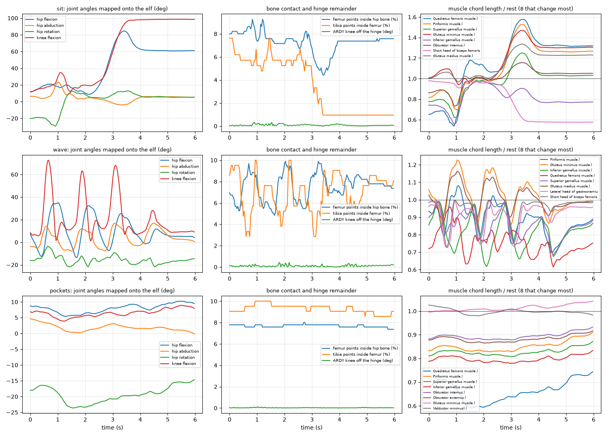

# From generative motion to the elf's bones and muscles

Research note and first test, 2026-11-23. Subject: the elf only.

**Question.** Generative motion models (NVIDIA ARDY, Kimodo, MotionBricks) output motion on their own skeletons. How do we map
that motion onto the elf's fitted anatomical skeleton (277 bones, 683 muscles)? Then, with an established muscle-bone engine or
our own, how do we simulate what that movement does to bones, muscles and flesh?

**Short answer.**
- **The mapping:** fit the elf's own anatomical joints, with their own degrees of freedom and limits, to the generated skeleton's
  joint *positions and bone directions*. Do not copy its rotations. This is how AddBiomechanics, OpenSim and GMR all do it.
- **The engine:** run the result kinematically through a MuJoCo or OpenSim style musculoskeletal model built from our fitted bones,
  to get muscle path lengths and joint loads. Run flesh in Newton (already installed) with the bones kinematic.
- **What the first test showed:** ARDY's knees and elbows already behave as hinges. Its hips and shoulders are free balls. The
  biggest error source is the **rest-pose calibration** between ARDY's T-pose and the elf's own neutral pose, not the joint types.

**Shared rules:**
- Muscle-path computation stays kinematic until muscle parameters for a 0.98 m figure can be justified.
- No tuned numbers: joint centres and axes come from the fitted bones, ranges of motion from a cited model, calibration from data.

---

## 1. The source skeletons, as they really are

Checked in our local ARDY checkout (`E:\code\ardy`, commit e706e27) and its docs.

| Model | Skeleton it predicts | Exported as | DOF | Licence |
|---|---|---|---|---|
| **ARDY**, SOMA model (`ARDY-SOMA-RP-30FPS-Horizon60`, 2026-10-15) | **somaskel30**: Hips, Spine1, Spine2, Chest, Neck1, Neck2, Head, Jaw, eyes; per side Shoulder (clavicle), Arm, ForeArm, Hand, ThumbEnd, MiddleEnd, Leg, Shin, Foot, ToeBase (`ardy/skeleton/definitions.py:185`) | somaskel77: fingers **filled from a fixed relaxed-hand rest pose** (`to_SOMASkeleton77`, line 250); contacts 4 → 6 | Every joint a free 3-DOF rotation (rotation matrices), no limits; root path in metres; 30 fps; Y up, +Z forward | Code Apache-2.0; weights NVIDIA Open Model Agreement |
| ARDY Core / G1 | Core 27 joints (20 fps); Unitree G1 1-DOF joints (25 fps) | — | — | same |
| **Kimodo** (ARDY's predecessor) | somaskel30 → 77, same filling; also SMPL-X-22 | — | 6D global rotations + pelvis-relative positions + root + 4 contacts | Apache-2.0 / NVIDIA Open Model |
| **MotionBricks** (SIGGRAPH 2026) | SOMA and G1; joint count **[unconfirmed]** | — | In-betweening from recent and target poses; TensorRT runtime | Apache-2.0 / NVIDIA Open Model |
| **SOMA-X** body model | 77 joints, axis-angle, T-pose-relative | BVH (cm, Y up) in BONES-SEED | — | Apache-2.0 |

**Consequences:**
- **Fingers.** Generated fingers never move, so finger motion must come from elsewhere: the user's own optimisation, or the
  AAOS-range poses already in `rig/hand_pose.py`.
- **Forearm.** It has one free joint at the elbow plus the hand. Pronation and supination hide in those two rotations and must be
  split onto the radius and ulna.
- **Spine.** It has three segments, against the elf's 24 vertebrae.
- **Shoulder.** It has one clavicle joint, against the elf's clavicle, scapula and humerus.

## 2. How existing pipelines map a skeleton onto an anatomical one

None maps joints one-to-one. They all **fit the target's own degrees of freedom to positions**:
- **AddBiomechanics / SMPL2AddBiomechanics** ([repo](https://github.com/MarilynKeller/SMPL2AddBiomechanics), non-commercial):
  - Puts 57 bony and 48 soft virtual markers on the SMPL surface.
  - Solves bone scales and per-frame inverse kinematics (IK) on the BSM/OpenSim skeleton within its joint limits.
  - Bony markers carry the most weight. Bony-marker error 1.5–1.7 cm.
- **OpenSim** (Apache-2.0 API): Scale, then marker IK, then inverse dynamics, then static optimisation or CMC (computed muscle
  control). Joint limits are coordinate ranges.
- **GMR** ([repo](https://github.com/YanjieZe/GMR), MIT): MuJoCo/mink IK from SMPL-X or BVH to any MJCF, 35–70 fps on CPU.
  MuscleMimic used it with equality constraints for coupled joints and cut joint-limit violations from 12 % to 0.3 %.
- **ProtoMotions** (SOMA-77 → `soma23` MJCF): simply drops the 54 leaf joints.

**Where the two skeletons differ:**
- Joints the source lacks, such as the scapula, vertebrae and radius/ulna twist, are filled by the target's own coupled joints
  through the fit.
- Joints the target lacks are dropped.

## 3. Established musculoskeletal engines

| Engine | What it gives | Size | Hardware | Licence | Non-human proportions |
|---|---|---|---|---|---|
| OpenSim 4 + Rajagopal 2016 | IK, inverse dynamics, static optimisation, CMC, Moco; activations, forces, fibre lengths | 37 DOF, 80 leg muscles, torque-driven upper body | CPU | API Apache-2.0; model "MIT Use Agreement" | Scale tool scales segments and muscle lengths; Hill parameters for 0.98 m are extrapolations |
| MuJoCo + MyoSuite (myoLeg 80 / myoArm 63 / myoHand 39 units) | Tendon and actuator lengths per qpos; forward simulation | as listed | CPU (MuJoCo); GPU MuJoCo-Warp | MuJoCo Apache-2.0; MyoSuite licence **[unconfirmed]** | Scalable bodies |
| MS-Human-700 | 206 joints, 700 muscle-tendon units | large | CPU / GPU | Apache-2.0 | — |
| MuscleMimic MyoFullBody | 72 DOF, 416 muscles; reinforcement-learning (RL) imitation | H100-class training | — | **[unconfirmed]** | Warns that its scaling assumes adult anthropometry |
| KINESIS | Leg RL imitation, 80–290 muscles | ~10 days on 128 CPUs + A100 | — | BSD-3 | — |
| SKEL / BSM | 24 bones, 46 DOF: scapula on a thoracic ellipsoid, spine in 3 curvature joints, forearm pronation | — | — | Research use **[unconfirmed]** | Via SMPL β |
| **Newton** (installed: `E:\splat\.venv-sim`, 1.8.0) | VBD tetrahedral flesh, already run on Rikka; MuJoCo-Warp solver inside | — | GTX 1650 runs our flesh sim | Apache-2.0 | Any mesh |

**Learned controllers are out of reach locally.** Muscle-driven imitation (KINESIS, MuscleMimic) needs data-centre GPUs for days.
What fits a GTX 1650 is **kinematic**: pose the skeleton frame by frame, then read off:
- muscle path lengths;
- joint loads by inverse dynamics, once masses are set;
- flesh deformation from the Newton simulation, with bones as kinematic bodies.

## 4. Proposed mapping for the elf

1. **The elf's joint model, from its fitted bones.** Every joint is a centre plus axes, computed from the bone surfaces that face
   each other, as `leg_bend_test.py` already does for the hip (sphere fit to the femur head) and knee (condyle axis):
   - **Hip:** ball joint, 3 DOF.
   - **Knee:** hinge, plus the small rotation the fitted condyles allow.
   - **Ankle and subtalar:** two hinges.
   - **Shoulder:** sternoclavicular and acromioclavicular joints, plus the scapula gliding on the rib cage, plus the
     glenohumeral ball.
   - **Elbow:** hinge.
   - **Forearm:** radioulnar pronation axis.
   - **Wrist:** two axes.
   - **Spine:** 24 small joints, coupled by a smooth curvature, as in BSM's 3-segment model.
   - Joint limits come from a cited model (the coordinate ranges in Rajagopal / BSM .osim files) and are not set by hand.
2. **Calibration (the main finding of the test).**
   - Find the one pose of the generated skeleton that matches the elf's rest pose. Fit it by IK on bone directions, not by
     assuming the T-pose is the rest.
   - Express every later frame relative to that pose. The test below shows why this matters: without it, standing already reads as
     15–24° of hip rotation.
3. **Per-frame IK on the elf's own DOFs:**
   - **Targets:** the generated joint positions, scaled per segment by the ratio of bone lengths, plus bone directions. Feet stay
     on the ground through the generator's contacts.
   - **Solver:** GMR-style, mink/MuJoCo IK or a small scipy least-squares, within joint limits.
   - **What it gives:** the motion converted to anatomical angles, plus a per-frame list of what the anatomy could *not* follow,
     such as joints past their limit, residual distance and the knee's off-hinge part. That list is itself an answer to "what
     happens if moved that way".
4. **Simulation on top, in three levels of cost:**
   - **(i) Kinematic muscles.** Muscle paths from the fitted attachment areas over wrapping surfaces (MuJoCo spatial tendons with
     sphere and cylinder wraps at the hip and knee). Gives length and lengthening speed per muscle, and bone impingement.
   - **(ii) Inverse dynamics plus static optimisation** in OpenSim or MyoSuite on a scaled model. Gives joint torques and
     activations. Needs masses (from the flesh volume and tissue densities) and Hill parameters: scaled from Rajagopal, flagged as
     extrapolated for a 0.98 m figure.
   - **(iii) Flesh.** Newton VBD tetrahedral simulation with the bones moving kinematically as in (3). Muscles act as stiffer
     regions whose rest length follows (i). Gives bulge, crease and contact, and the data for the rig-stage correctives (see
     `docs/rig-stage-strategies.md`, strategy c).

## 5. First test: three ARDY clips on the elf's left leg (done, ~20 s CPU)

**Script:** `research/rig_stage/ardy_to_elf_leg.py`. It uses the existing clips `sit`, `wave` (walk and wave) and `pockets`
(30 fps, 6 s each).
- **Pelvis:** held still.
- **Hip:** ARDY's thigh rotation relative to its pelvis, applied as a ball joint about the fitted femur-head centre.
- **Knee:** the hinge part of ARDY's knee, about the fitted knee axis.
- **Muscles:** 32 leg muscles crossing the hip or knee, each measured as the straight distance between its attachment patches.

**Results (JSON: `E:\figures\elf_pipe\rig_stage\ardy_to_elf_leg.json`):**

| Clip | Hip flexion | Hip abduction | Hip rotation | Knee | ARDY knee off its hinge | Muscle stretched most (length / rest) |
|---|---|---|---|---|---|---|
| sit | 9 → 85° | −4 → 23° | −29 → 13° | 11 → 99° | ≤ 0.33° | quadratus femoris 0.54–1.58, piriformis 0.69–1.53 |
| walk + wave | −14 → 35° | −8 → 17° | −22 → −4° | 1 → 73° | ≤ 0.43° | gluteus minimus 0.85–1.23 |
| pockets (standing) | 5 → 10° | 0 → 5° | **−24 → −15°** | 4 → 9° | ≤ 0.11° | quadratus femoris **0.59–0.74** |

**What this shows:**
- **Knee:** ARDY's knee is effectively a hinge, under 0.5° off axis. Mapping it onto the fitted knee axis loses nothing. Its
  elbows stray up to 4.7° (measured separately). Hips and shoulders use all three axes, up to 33° off the main one.
- **Calibration:** standing reads as 15–24° of hip rotation, and the deep rotators then come out 20–40 % shorter than rest. That
  is the T-pose-versus-rest mismatch of section 4 step 2, not a real posture. It must be calibrated before any muscle number means
  anything.
- **Bone overlap:** 6.7 % of femur points already sit inside the hip-bone solid at rest, and 9.5 % of tibia points inside the femur
  solid. This is overlap left by the fit, so contact tests must be measured *against rest*. In motion the femur rises only to about
  10 %, with no clear impingement in these clips.
- **Straight chords are only lower bounds** for muscles that wrap (gluteals, piriformis). Level (i) needs wrapping surfaces before
  lengths can be compared with a muscle's working range.

## 6. Next cheap tests (each minutes, local)

1. **Calibration.**
   - Fit ARDY's neutral standing frame to the elf's rest by bone directions.
   - Re-run the test.
   - **Pass:** standing reads near 0° on every axis, and muscle lengths near 1.
2. **Whole-leg IK on the elf's DOFs.**
   - Scipy least-squares on joint positions and bone directions, with Rajagopal or BSM ranges read from their .osim files.
   - Report limit violations per clip.
3. **Wrapping.**
   - Install `mujoco`, after asking.
   - Build an MJCF of the elf's pelvis and leg: bodies at the fitted joints; spatial tendons from the attachment patches over a
     sphere at the femur head and a cylinder at the knee.
   - Compare tendon lengths with the chords.
4. **Shoulder and forearm.**
   - Same as tests 1–3 for the arm: clavicle and scapula motion shared out from ARDY's Shoulder plus Arm rotation, and pronation
     split from ForeArm plus Hand.
   - The elf's fitted wrist under the warmer is unreliable (devlog), so check it first.
5. **Flesh.**
   - The `sit` clip through Newton on a tetrahedral mesh of the elf's leg, bones kinematic.
   - Compare with the binding audit in `docs/rig-stage-strategies.md`.
