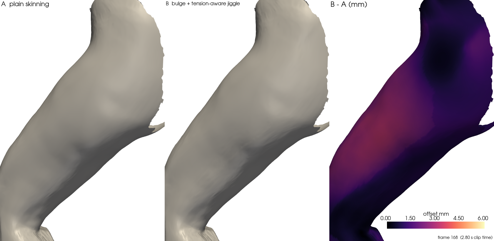
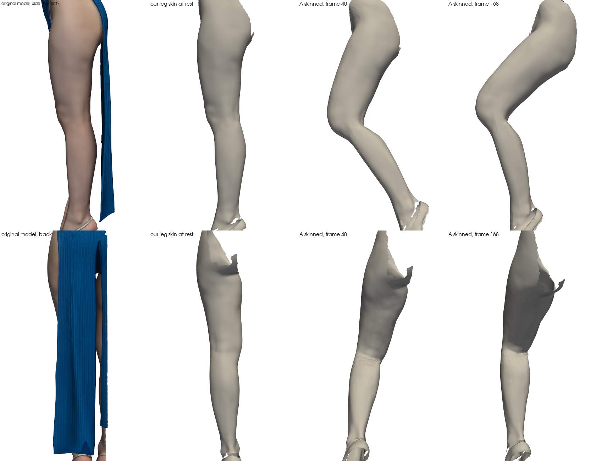
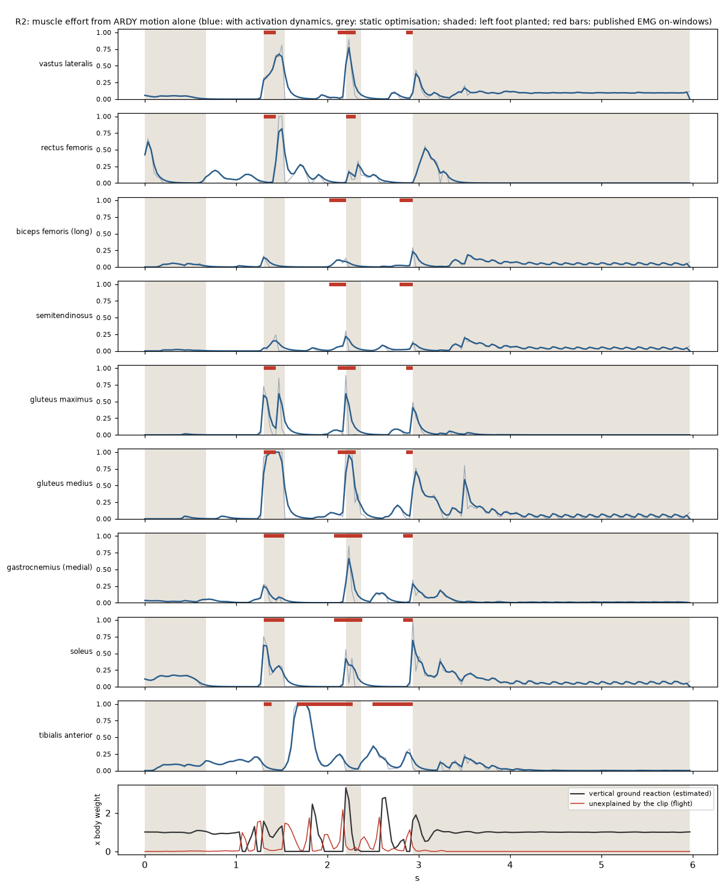

# Live flesh at minimum compute — plan (2026-11-24)

**Goal.** Flesh that moves like real flesh, live, beside a motion model such as ARDY, in games and on VRChat/VRM avatars,
covering action and breathing. Today's flesh looks fake because the jiggle settings never change, muscles never bulge, skin
never slides over muscle, nothing squashes on contact and nothing breathes.

**Mindset.** We know the bones and muscles under each character. Most of the interior never shows on the outside, so the
anatomy is used **offline, once per character**, to work out a few facts per patch of skin. The live part stays tiny.

What the outside needs, per patch of skin:

| fact | where it comes from |
|---|---|
| fat depth, soft mass under the skin | the character's interior (atlas fit + fat) |
| which muscle is under it, how hard it works this frame | ARDY motion → joint torques → muscle activation |
| bulge direction and size when that muscle works | offline simulation |
| wobble frequency and damping, relaxed vs tensed | offline simulation, checked against human measurements |
| squash on contact | offline simulation (sitting, pressing) |

## Runtime (live, per frame)

The live inputs are the bone motion ARDY generates and **the shape, position and velocity of every outside object the body
touches** (floor, chair, another body, a hand), plus the character's fixed offline data. Everything else is computed
inside the runtime. Objects matter twice: they squash the flesh (step 4) and they carry weight (sitting puts the body's
weight through the seat, not the feet, which changes every muscle's effort in step 1).

1. **Muscle activation**, computed from the motion, not supplied: the ground forces are estimated from the motion and the
   feet's contact (the whole body's acceleration fixes their total; the split between two feet is part of the next step);
   any other touching object takes its share the same way, from its contact patch;
   inverse dynamics gives each joint's torque; a small per-frame optimisation shares each torque among the muscles that
   cross the joint (about 40 per leg), by least effort, or a small learned stand-in for it.
   Limit: tensing without moving (bracing, flexing in place) does not show in the motion. Least effort assumes none; an
   optional "tension" input could add it later.
2. **Bulge**: corrective shapes driven by joint angles and activation (SMPL pose correctives, SoftSMPL).
3. **Jiggle**: a few damped wobble modes per body region, driven by bone acceleration; stiffness rises with activation
   (reduced dynamics: Barbič & James; Dyna/DMPL).
4. **Contact**: a local correction from the touching object's shape and motion, computed only where and while something
   touches (learned contact corrections with general collider descriptors, Romero et al. 2021). Training in R3/R6 uses
   varied object shapes, not one chair, so new objects work.
5. **Breathing**: rib bones and belly shape driven by a breathing signal tied to exertion.

Target: well under 1 ms per character per frame. Delivery: a small runtime (CPU or one compute pass) that game mods can
load, so it may run any code; VRM and VRChat avatars are out of scope for now (user, 2026-11-24).

## Phases

| | phase | what it does | done when | compute |
|---|---|---|---|---|
| R0 | **proof** | one ARDY clip on the elf, legs and hips: A plain skinning, B small runtime (bulge + jiggle that stiffens with activation) with settings from cited human measurements | B clearly looks more real, under 1 ms/frame on the GTX 1650; side-by-side video | local, hours |
| R1 | mod runtime shape | the runtime as a small library with one call per frame (bone transforms + activation in, vertex offsets out), so a game mod can host it | runs standalone with a test harness; frame time logged | local |
| R2 | activation from motion | ARDY motion → torques → muscle activation each frame, with the elf's own masses and the muscles' moment arms | activation patterns match published gait EMG timing | local |
| R3 | offline teacher, per character | coarse layered simulation of the character (bones, muscle volumes, fat, skin; Newton VBD; layers tied, sliding only where it shows). Training motions cover **local states, not a list of actions**: broad random sampling from ARDY itself, plus targeted excitations (sudden stops, impacts, holds at the ends of each joint's range, activation sweeps from relaxed to full) | stable runs; per region, the training covers the range of joint angles, bone accelerations and activations seen in ARDY | local first; HF Jobs with a cost table if slow |
| R4 | fit the runtime | a learned flesh **response** model: input = bone motion over the last fraction of a second (activation is computed from it inside, step 1 of the runtime), output = surface offsets. Physics-shaped (bulge shapes + damped wobble modes whose stiffness follows activation), with a small learned correction | error measured on **held-out ARDY motions never used in training**, per region | local |

The runtime must answer any motion ARDY can generate, so R3's clips are training data, not a lookup table. It can
generalise because flesh responds locally: a patch of thigh only feels the nearby joints, the leg's acceleration and a few
muscles' activation over roughly the last half second. That space is far smaller than the space of whole actions, and it
is what R3 has to cover. Unlike ARDY, this model is not generative: given the motion, the flesh is set by physics, so a
small deterministic model is enough.
| R5 | breathing | rib and belly motion from a breathing signal; rate tied to exertion | visible, plausible breathing at rest and after a run | local |
| R6 | contact | sitting and pressing corrections (the old T7 buttock-on-chair scene) | squash matches the teacher | local / HF |
| R7 | live test | ARDY live + runtime on the elf; frame time; side-by-side against plain skinning; whole body | the user judges it real; frame budget met | local |

Every phase gets a notebook in `notebooks/` and pictures as it goes.

## What happens to the earlier engine plan (plan.md)

- It becomes the **offline teacher** (R3, R6) and runs at coarse resolution. The 0.77 mm thigh pack is not needed for that.
- Kept: the E-MAT tissue parameters (woman about 28), the tissue research, the stance findings, and the GPU label grid +
  surface nets route (2.5 min instead of 68 min).
- Not needed for now: a converged fine-mesh anatomy sim with sliding contact everywhere; it is far beyond 60 Hz and most
  of it never shows.
- Later option: run the teacher once over many generated bodies and learn the settings, instead of once per character.

## Results so far (2026-11-24)

Notebook: `notebooks/flesh_runtime.ipynb` (ARDY clip → muscle effort → runtime → video).

### R0, proof: passed for cost and smoothness

- Clip: ARDY "A person jogs forward, then jumps up and lands." (6 s, 29 flight frames) on the elf's left leg and hip.
- Runtime B on top of plain skinning A: bulge (constant-volume shortening + cited active thickening) and one damped
  wobble per muscle compartment whose stiffness and damping follow the compartment's effort. Settings:
  `r0_params.json`, from `tissue-research/flesh-dynamics-r0.md` (mostly male or mixed data; adductor and buttock wobble
  use thigh-front values as stand-ins).
- **Cost (GTX 1650):** B's per-vertex work 0.30 ms at the leg's 47k vertices, 0.86 ms at 1M; the wobble oscillators
  0.26 ms in numpy (`r0_runtime_bench.py`).
- **Smooth skin:** the leg skin is 60 texture patches; joined at coincident points into one surface. A uses bone-heat
  weights (Baran & Popović 2007). Worst skin stretch at the deepest bend 36× → 5.6× (p99 4.3× → 1.7×).
- **Offsets:** median 0.4 mm, up to ~8 mm; compartment wobble peaks 3.5–5.6 mm (the elf is about half human size).
- **Known gap, left for R4/R6:** the back of the knee collapses when bent (back-side skin moves ~16 mm, calf girth
  −3…−9 %): plain skinning has no crease and no calf–hamstring contact. The rest shape matches the original model.

### R2, muscle effort from motion: first pass

- **Ground reaction from the motion itself** (Ren, Jones & Howard 2008): the free root's required force and moment
  are shared among heel and toe points of the feet ARDY labels planted, inside the friction pyramid (NNLS); forefoot
  load goes to the foot segment (metatarsal heads), not the toes. Feet carry 1.0 BW standing, up to 3.3 BW landing;
  before, an invisible root force carried 40–60 % of the weight.
- **Activation dynamics:** the model's own (MuJoCo muscle, 10 / 40 ms): the drive needed to follow the static
  optimisation is capped to [0, 1] and played forward.
- **Foot:** turns about the axis through the malleoli tips (Inman 1976) by ARDY's ankle angle.
- **Against published running EMG** (`r2_emg_windows.json`, from `tissue-research/running-emg-r2.md`; Chumanov 2012,
  Gazendam & Hof 2007): vasti, rectus femoris, gluteus maximus and medius, gastrocnemius and soleus fire at foot strike /
  early stance, tibialis anterior in swing, as published. Misses: hamstrings barely fire in late swing (published peak
  80–100 % of the cycle); gluteus medius and tibialis anterior saturate where runners use about a third to a half.
- **ARDY's own limit:** in flight the clip's hips need a median 0.7 BW that nothing provides (a kinematic generator
  does not respect ballistic flight); measured and shown, not hidden.

