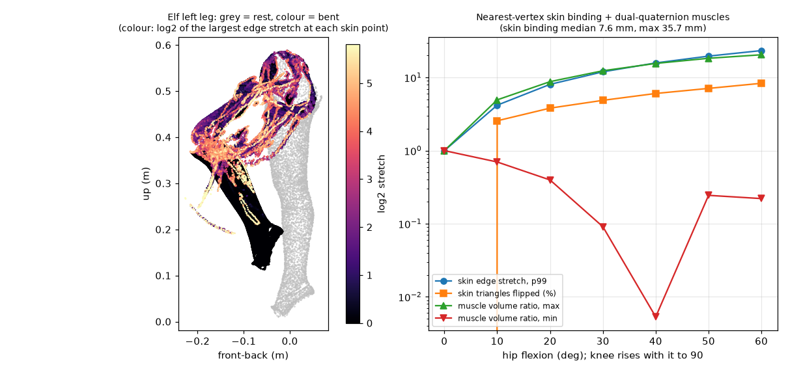

# Rig stage: strategies from the fitted anatomy to an animated VRM 1.0 character

Research note, 2026-11-23. No code was changed outside `research/rig_stage/`. Sources: the repo docs and saved fits (inventory in
section 1), and a survey of papers, repos and licences (section 2). **[unconfirmed]** marks claims not checked against a primary
source; **[judgement]** marks my own estimates.

**Summary.**
- **The Rikka twin has no anatomy fit yet.** Bones, muscles and fat were fitted only on the elf. The Rikka twin has a 52-bone
  Make-It-Animatable rig, a SOMA body, a tetrahedral flesh mesh with a Newton simulation, and a face and iris rig. So the rig stage
  can start on Rikka with what exists, while anatomy-driven weights are tested on the elf first.
- **The current binding fails.** The one-leg audit on the elf binds skin to the nearest muscle or bone vertex. At hip 60° / knee 90°
  it tears the thigh: p99 edge stretch 23×, 8 % of skin triangles flipped, muscle volume 0.2×–20× (figure below).
- **Recommended:**
  - **A, now:** derive skin weights by diffusing through the flesh volume, with the fitted bones as fixed handles. Use harmonic
    weights, or bounded biharmonic weights (BBW) via libigl. Add roll twist bones (VRMC_node_constraint). Export standard
    4-influence linear blend skinning (LBS) as VRM 1.0 through the Blender VRM add-on.
  - **B, next:** bake the Newton flesh simulation into pose-driven corrective shapes. Use an SMPL-style linear regression on joint
    rotations, but fitted to our own simulation, not SMPL weights. Ship them as glTF morph targets driven by a small three.js script.
  - Spring bones only for hair and cloth. The PINN stays parked unless B's linear correctives fall short.
- **Cheap tests (section 4):** each runs locally in minutes and decides whether to go on.

*Elf left leg, rest (grey) and bent (colour = log2 of the largest edge stretch at each skin point). Right: per-frame metrics of
the existing audit (`model_to_vrm/rig/leg_bend_test.py`). Made by `research/rig_stage/leg_audit_figure.py` from
`leg_bend_l.json/npz`; the elf is a fictional figure.*

---

## 1. What has been fitted, and where

### 1.1 Rikka T-pose twin (`E:\figures\rikka\tripo\transfer\`, 2026-11-18)

**Units and frame:** Tripo units with z up, about 1.84 units tall. That differs from the SOMA body (about 0.96 tall); the two frames
have not been reconciled.

| Piece | File and content | Made by | Quality / known defects |
|---|---|---|---|
| Twin mesh | `twin_in.npz` (53k vertices, part labels); `twin_full.npz` (961k) | Tripo T-pose | — |
| Skeleton + weights | `twin_rig.npz`: W 52,833×52; 52 `mixamorig:*` bones with names, parent, head, tail; 3 bones per finger; ToeBase only; no jaw or eye bones | Make-It-Animatable (HF Jobs), which beat UniRig (devlog :94) | Learned weights; not tied to anatomy |
| Bend to the setting pose | `ab_free.npz` (Vbent, W, Rg); weights carried onto the original: `orig_weights_free.npz` | `rig/fit_pose_ab.py`, `rig/carry_weights.py` | Surface miss 4.6 mm median |
| Layers | `layers/twin_layers.npz`, 5 classes per point | — | — |
| Body | `body/body_fit.npz`: SOMA, 18k vertices, 77 joints, 8-bone LBS | `motion/body_fit.py`, `soma_stretch.py` | Watertight; skin 3.2 mm median. Pointed skull, crumpled face, step at thigh tops, shoulder dent, inverted heels (bottom-up-plan :93) |
| Flesh | `flesh/tetwild.npz` (25k nodes, 118k tets, skin embedding); `flesh/wave_newton.npz` (180 frames) | `flesh/body_tetwild.py`, `flesh/newton_flesh.py` (Newton VBD, E 30 kPa, ν 0.45) | Volume 98.7–99.4 %; ≤ 20 tets inverted; 2 mm mean off from LBS (p99 12.5 mm); **hands smear up to 15 cm** |
| Face | `flesh/face_rig.npz` (jaw weights and pivot, eye centres, mouth corners, visemes aa/ih/ee/oh/ou); iris rig `rigged/rikka_twin_eyes.glb` | `face/face_rig.py`, `rig/build_twin_rig.py` | Prototype |

### 1.2 Elf anatomy fit (`E:\figures\elf_pipe\anatomy_dense\`, metres, z up, 0.98 m)

| Piece | File | Quality |
|---|---|---|
| 277 rigid bones | `skeleton_fit.npz` (params 277×9, R0, P, C, A, t, V_rigid, contact_pairs) | Residual 2.1 mm median, p90 6.3 mm; joint gaps 0.2 mm; 4 % of bone points outside the skin |
| Whole-body assembly | `body_assembly.npz` (106 free / 171 held bones) | Named joints 8.1 mm median, 22 mm max |
| Hands, feet, toes | `hand_{l,r}_bones.npz`, `foot_{l,r}_bones.npz` | Hand joints 3–5 mm spread; the wrist under the warmer is unreliable |
| Ends refine | `skeleton_refined*.npz` | **Failed:** phalanges grew 3–6×; paused |
| Skull and face bone | `skull_stage2.npz` | Bone under the philtrum 6.0–7.8 mm deep |
| 683 muscles | `muscle_repair.npz` (V, F_muscle, CSR bone shares `W_*`, depth, in_bone) | 0.02 % outside the body; **16 % of muscle points inside bone** |
| Fat | `fat_layer.npz` | HIT statistics; too thick on slim figures; comparison only |
| One-leg rig audit | `leg_bend_l.json/npz` | See the figure above |

### 1.3 What is missing for a deforming VRM 1.0 character
- An anatomy fit on Rikka.
- Joint frames from the fitted bones: centres, axes, twist and ranges of motion. Only the leg audit's hip sphere and knee axis exist.
- A binding of the visible skin to the anatomy that does not tear.
- 4-influence weights.
- A VRM humanoid mapping and a VRM writer in this repo. A Blender one exists in the sibling project
  `novel-ontology-pi/engine/characters/pipeline/dress_rig.py`, using bone heat.
- Expressions and lookAt; spring bones and colliders.
- Toe bones.
- Conversion from Tripo units, z up, to VRM's metres, y up, facing +z.

The plans already name the target:
- milestone M4 Rig (`docs/milestones.md:16`);
- the handout's finish line "fit once, bind once, play a motion clip not seen before" (`docs/interior-model-handout.md:188`);
- v7 milestone 21 Rig and milestone 23 Limbs, "fingers and toes by the existing optimization" (`docs/interior-model-plan-v7.md:425-427`);
- the PINN, parked until this stage (v7:261).

---

## 2. Candidate strategies

### (a) Skin weights from the fitted anatomy, then LBS

**What it needs:**
- the skin mesh;
- a volume mesh of the flesh between the bones and the skin (fTetWild/pytetwild; Rikka already has `flesh/tetwild.npz`);
- the fitted bones as handles. These are bone meshes on the elf; on Rikka for now, MIA bone segments.

**Methods:**
- **Harmonic weights through the volume.** A sparse Laplace solve with scipy, no new install. Each bone's region is fixed to 1 for
  that bone and 0 for the others.
- **Bounded biharmonic weights** (BBW; Jacobson 2011). In libigl, `igl.bbw`; PyPI `libigl` 2.6.3 is MPL-2.0. Avoid the GPL
  folders and the AGPL tetgen.
- **Robust Skin Weights Transfer** ([code](https://github.com/rin-23/RobustSkinWeightsTransferCode), MIT, Python + libigl). Moves
  weights from a proxy (the muscle and bone binding) onto the skin, then inpaints where the match is poor. It also fixes weight
  bleed between fingers.
- Geodesic voxel binding (Dionne & de Lasa 2013) exists only inside Maya; its idea, voxel geodesic distance from bones, is easy to
  copy.
- Blender bone heat works on the surface only and leaks across touching parts.

**Runtime:**
- three.js and VRM support **LBS only**. Dual-quaternion skinning would need a custom shader, which VRM viewers would not run.
  Volume keeping must therefore come from helper bones or correctives.
- Assume 4 influences per vertex **[unconfirmed]**.

**Learned auto-riggers:**
- Make-It-Animatable (already used), UniRig (MIT, ≥ 8 GB, so HF Jobs), Puppeteer / MagicArticulate (Apache-2.0), RigNet (GPL-3.0).
- They ignore our fitted bones. Useful only as a comparison prior.

### (b) Layered rig plus secondary motion

**VRM 1.0 has no runtime layer between skeleton and skin.** Muscle and fat layers have to be baked into weights, helper bones or
morph targets. What VRM does offer:
- **VRMC_node_constraint** ([spec](https://github.com/vrm-c/vrm-specification/tree/master/specification/VRMC_node_constraint-1.0)):
  roll, aim and rotation constraints with a weight. three.js support: `@pixiv/three-vrm-node-constraint`, MIT. This is the
  VRM-native fix for wrist and forearm twist (the "candy wrapper"), upper-arm twist and thigh twist. The constraint weights should
  be fitted, for example to the twist the flesh simulation spreads along the forearm, not set by hand.
- **VRMC_springBone 1.0:**
  - Verlet chains with sphere and capsule colliders.
  - No angle limits, and no collision between chains.
  - Right for hair, skirt and cardigan hems, chest and belly jiggle. Unable to show muscle bulge.
  - The sibling viewer already runs three-vrm spring bones: walk 17 mm and run 68 mm of hair swing (devlog :86).

### (c) Physics flesh around rigid bones, baked to real time

**Simulate offline:**
- [Newton](https://github.com/newton-physics/newton) (Apache-2.0, on Warp; already used in `flesh/newton_flesh.py`) or
  [Vega FEM](https://viterbi-web.usc.edu/~jbarbic/code/index.html) (BSD-3, CPU).
- Bones are kinematic nodes. Methods in this family: projective dynamics with articulated skeletons (Li, Liu & Kavan 2019),
  Anatomy Transfer (Ali-Hamadi 2013), Computational Bodybuilding (Saito 2015, which can also regularise the fat layer).

**Bake:**
- Pose-space deformation (Lewis 2000): radial-basis interpolation of corrections over pose.
- Or SMPL-style linear correctives: corrections regressed on (R − I) of each joint, fitted to the simulation output.

**Ship:**
- glTF morph targets. Their pose-to-weight mapping is not part of VRM, so a small three.js script drives them.
- three.js on WebGL2 packs morph targets in a texture: the count is limited by the device, and the cost is roughly vertices ×
  active targets.

**Not usable:** PhysGaussian (no licence file; Inria code).

### (d) A learned deformation model over pose (and shape)

- **SMPL / SMPL-X, STAR and SUPR weights are non-commercial or academic only.** Use their *formulation* on our own simulation data.
- Garment and soft-tissue networks (HOOD, MIT but SMPL-bound; SoftSMPL, no code found) need cloud GPUs and SMPL.
- **PINN surrogate** (v7 parks it here): one network over pose, and later over body shape, trained on the flesh equations.
  - It is only worth having if the linear correctives in (c) leave a clear residual.
  - In the browser it would run as a small multilayer perceptron (MLP) in ONNX Runtime Web or a TSL compute shader. It would output
    about 32–64 basis weights, not per-vertex offsets **[judgement]**.

### (e) Fingers, toes, wrists, ankles, jaw

- **Fingers and toes** come from the user's own optimisation (v7 milestone 23). Weights:
  - BBW or harmonic weights per finger, with that finger's bones as handles;
  - Robust Skin Weights Transfer limited to each finger, to stop bleed between neighbours.
  - VRM has 3 humanoid bones per finger and one optional toe bone; extra toe bones are allowed as non-humanoid nodes.
- **Wrists and ankles** come from the learned interior model. Wrist: forearm roll bones (b) plus one flexion corrective. Ankle: LBS
  plus a heel/Achilles corrective.
- **Jaw:** VRM 1.0's optional `jaw` bone with teeth and tongue rigid on it, and lips as expressions. VRM expression presets aa / ih /
  ou / ee / oh map directly onto `face_rig.npz`'s visemes. Anime faces usually go all-morph **[judgement]**.

---

## 3. Comparison

GPU column: whether it runs locally on the GTX 1650 (4 GB) or needs HF Jobs.

**Main table: needs, licence, hardware and cost**

| | Strategy | Needs from our anatomy | Open code (licence) | GPU | Browser cost |
|---|---|---|---|---|---|
| a1 | Harmonic / BBW weights in the flesh volume + LBS | Skin, flesh volume mesh, bone handles | scipy; libigl (MPL-2.0); fTetWild (MPL-2.0); Robust Skin Weights Transfer (MIT) | Local CPU, minutes **[judgement]** | Plain skinning |
| a2 | Learned auto-rigger | Skin only | Make-It-Animatable (MIT/Apache, check); UniRig (MIT) | HF Jobs | Plain skinning |
| b | Twist / roll helper bones + spring bones | Joint axes, twist spread | three-vrm (MIT), node-constraint (MIT) | none | Tiny |
| c | Physics flesh baked to correctives | Bones, flesh volume, joint ranges of motion | Newton (Apache-2.0), Vega (BSD-3) | Sim local (Newton already runs) | Vertices × active targets, every frame |
| d | Learned surrogate / PINN over pose | Sim data, many poses | torch; ONNX Runtime Web (MIT) | Training: HF Jobs | MLP per frame + basis |
| e | Fingers/toes from own optimisation + per-finger weights | Finger bones (optimisation) | as a1 | Local | as a1 |

**Expected quality and risks.** All quality ratings are **[judgement]**.

| | Strategy | Shoulder / hip | Wrist | Jaw | Main risks |
|---|---|---|---|---|---|
| a1 | Harmonic / BBW + LBS | LBS volume loss at large angles | Candy wrapper without (b) | Fine with its own handle | BBW solve size past ~100k tets; 4-influence pruning |
| a2 | Learned auto-rigger | Good on Mixamo-like bodies | ok | none | Ignores the fitted bones; Mixamo terms |
| b | Twist / roll helpers + spring bones | Helps the twist part | **Fixes the candy wrapper** | — | Constraint weights must be fitted, not set |
| c | Physics flesh → correctives | **Best**: bulge, crease, contact | Good | Good | The hands already smear in the Newton sim; quality depends on the sim |
| d | Learned surrogate / PINN | As c, plus dynamics | As c | As c | Data cost; SMPL licences if borrowed |
| e | Fingers/toes + per-finger weights | — | — | — | The ends-refine fit failed; wrist under the warmer unreliable |

---

## 4. Recommendation and cheap tests

**Pick a1 + b now and c next.**
- (a1) and (b) give a correct, VRM-native rig that works on any viewer.
- (c) adds the quality at the shoulder, hip and jaw on top, without changing the rig.
- (a2) stays as a comparison baseline; Make-It-Animatable weights already exist.
- (d) and the PINN are revisited only if T-R4's linear correctives leave a residual above the simulation's own noise.

**Rules for every test below:**
- No tuned numbers: every threshold is an Otsu split, a held-out elbow or a fitted value.
- Each test runs as a notebook cell, writes a JSON of metrics and a picture, and needs nothing new installed except where marked.

| Test | What it runs | Data | Time | Decides |
|---|---|---|---|---|
| **T-R1 Volume weights** | Harmonic weights through a tet mesh of the elf's left leg, fitted bone meshes as handles. Re-run the existing leg-bend clip with the same metrics as the audit (p99 edge stretch, flipped triangles, binding error) | `skeleton_fit.npz`, `muscle_repair.npz`, `leg_bend_l.*`; pytetwild in `E:\splat\.venv-sim` | ~10 min CPU | Whether volume weights remove the tearing. Pass if flips go to ~0 and stretch matches the Make-It-Animatable baseline on the same clip |
| **T-R1b BBW** | Same with `igl.bbw` | **Needs `pip install libigl` (ask first)** | ~10 min | Whether the bounded version beats harmonic at the hip |
| **T-R2 Rikka weights** | Rikka twin: harmonic weights in `flesh/tetwild.npz`, MIA bone segments as handles, against the shipped MIA weights, on the same ARDY clip | `tetwild.npz`, `twin_rig.npz` | ~10 min | Whether to replace or keep MIA weights before the anatomy fit reaches Rikka |
| **T-R3 Twist** | Forearm twisted through its range of motion with 0, 1 and 2 roll bones. Constraint weights fitted to how twist spreads along the forearm in the flesh simulation. Measure cross-section area from the polar outline r(θ) (as `za_slices.py`) | elf forearm or Rikka forearm | ~5 min | Number of roll bones per limb |
| **T-R4 Corrective bake** | From `wave_newton.npz` (simulation minus LBS per frame), fit linear correctives on joint rotations. Choose the number of PCA bases at the held-out error elbow, and report held-out mm error against the number of morph targets | `wave_newton.npz`, plus the per-frame poses (re-log them if not stored) | ~5 min | Whether (c) is worth it, and how many targets. A residual above simulation noise brings (d) back |
| **T-R5 Browser budget** | three-vrm page with the twin at its real vertex count and N = 0…128 morph targets driven per frame; measure fps in the browser pane (desktop) and with mobile emulation | synthetic targets | ~5 min | The ceiling on N for (c) |
| **T-R6 Export round trip** | Twin + weights + humanoid map + roll constraints + one spring chain, written headless with the Blender VRM add-on (`bpy-vrm-format`, MIT OR GPL-3.0) and loaded in three-vrm | twin | ~5 min | That the VRM 1.0 path works before quality work |

**After these:**
- A long run is a full-body bake (c) over an ARDY motion set.
- It is profiled on one clip locally first.
- It goes to HF Jobs only with the user's approval and a cost table.

**Not yet decidable:**
- How the anatomy-driven weights look on Rikka. That needs the Z-Anatomy chain to run on the twin first.
- Whether the Newton hand smear (15 cm) is a simulation setup problem or needs finger bones inside the flesh.
