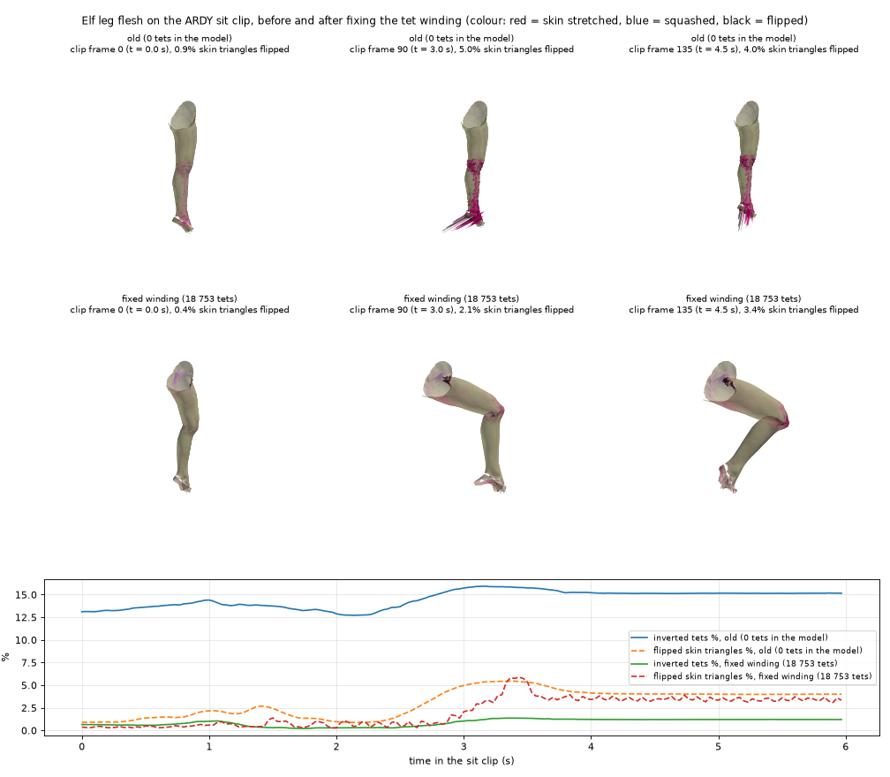
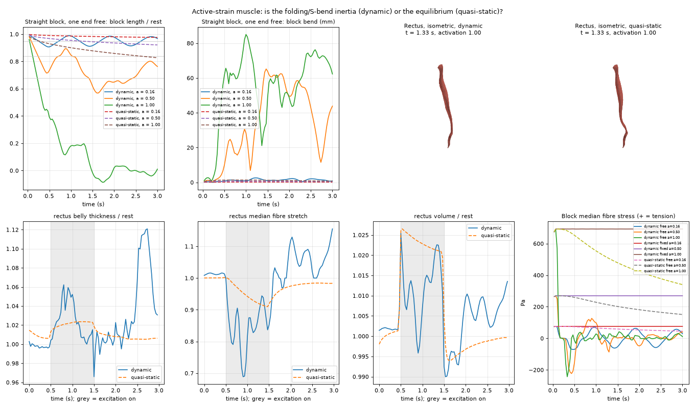
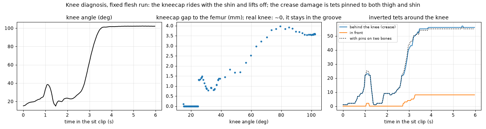

# Research handoff: a physics body that sits down like a real person

Drafted 2026-11-24. Subject: the elf (0.98 m), left leg and pelvis first. Machine: GTX 1650 laptop (4 GB VRAM, i7-9750H, 32 GB RAM).
Bigger GPU work runs as HF Jobs, and only after asking with a cost table.

**The question.** We have a Z-Anatomy atlas warped into the elf and an ARDY "sit" clip. How do we get a simulation where:
- the bones,
- the muscles, which contract when active,
- the fat and skin over them,
- and the contact with the chair

together look and measure like a real person sitting down, and can run on this laptop?

**Short answer.** Split it into two coupled layers, as the literature does:
1. **Skeleton and activations: a line-of-action musculoskeletal model** (MyoSuite or OpenSim). It is cheap and gives joint torques,
   contact loads and per-muscle activations.
2. **Soft tissue: a volumetric layer** (muscles, fat and skin as tetrahedra in Newton VBD). The bones move it and the activations
   from layer 1 drive it. It gives the shapes: bulging, sliding, and the buttock and thigh flattening on the seat.

Neither layer alone looks right:
- Layer 1 is lines by construction. That is why the current viewer shows straight grey strings.
- Layer 2 alone has no motor. It is a bag of jelly glued to bones, as the single rectus tube showed.

The missing work is mostly in layer 2:
- **all** thigh and hip muscles at once, sliding on each other inside fascia;
- a fat layer and a skin layer;
- damping;
- chair contact on the flesh, not on the bones.

---

## 1. What "looks like a real person" means (acceptance tests)

All checks are against published data, never against eyeballing alone.

| level | measure | reference data |
|---|---|---|
| Kinematics | hip, knee and ankle angles and trunk lean over stand-to-sit; pelvis height path | sit-to-stand / stand-to-sit biomechanics (e.g. Roebroeck et al. 1994, Clin. Biomech.); ARDY's own clip |
| Loads | ground and seat vertical reaction share over time; no large residual force at the root | same literature; our run gives feet 0.27 bw and seat 0.73 bw seated, to be checked |
| Muscles | which muscles are active and when: quadriceps working eccentrically while lowering, then quiet when seated; tibialis anterior early | EMG in sit-to-stand papers; MyoSuite static optimisation is the first estimate |
| Tissue | buttock and thigh compression under the ischial tuberosities **and the direction the tissue moves (down and along the thigh)**; muscle thickness change under load; for a left-side model, a stated left share of the seat load | Linder-Ganz et al. 2007 (open-MRI of sitting + FE); Al-Dirini et al. 2016 (seated buttock-thigh FE model) |
| Numerical health | volume ratio per muscle ≈ 1; no inverted tets; no node inside bone; skin triangle flips < 1 %; settles after motion (no ringing) | our own metrics in `newton_muscle_active.py` |

Pictures of real people and per-person scans stay out of the public repo. The MRI papers are used only as numbers.

## 2. What we already have

| item | where | notes |
|---|---|---|
| Z-Anatomy atlas warped to the elf: 277 bones, 683 muscles, fascia, bursae, skin regions; 1.58 M vertices | `E:/figures/elf_pipe/anatomy_dense/atlas_warp.npz` (`V`, `F_bone`, `F_muscle`, `F_skin`, `obj`, `names`, `system`) | CC BY-SA 4.0. Based on BodyParts3D, a single adult male. Fascia objects exist (e.g. `Crural fascia.l`, intermuscular septa) |
| Repaired muscle surfaces, bone skinning weights, muscle depth and in-bone flags | `anatomy_dense/muscle_repair.npz` | gastrocnemius insertion is bad; excluded so far |
| Fat depth under the skin | `rig_stage/skin_fat.npz` | from the elf's surface |
| ARDY clips mapped to the elf's leg (hip, knee angles + thigh/shank transforms) | `rig_stage/{sit,wave,pockets}_leg_transforms.npz` | rest-pose calibration done (doc `motion-to-anatomy-mapping.md` §6) |
| Flesh-only leg in Newton VBD, 18.8 k tets, sit clip, 241 s on the 1650 | `research/rig_stage/elf_leg_flesh.py` | **the first run was invalid**: fTetWild's winding made Newton drop every tet, so the leg never bent (§6, test 1). Fixed: inverted tets ≤ 1.4 %, skin flips ≤ 5.9 % (knee crease, hip) |
| One muscle (rectus femoris) as a tet tube with glue, bone contact and active strain | `research/rig_stage/newton_muscle_active.py` | contact: 0 penetration; contraction: volume kept, but S-bends; rings with no damping; swings loose |
| MyoSuite myoLegs static optimisation of the sit | `research/rig_stage/myo_sit_activations.py`, result `rig_stage/myo_sit.npz` | 80 muscles; generic adult proportions, not the elf's; trunk held by a 64 N·m reserve torque |
| Viewer of that result | private artifact "Sit-Down Muscle Viewer" | shows lines of action; see §4 for what looks wrong |

Installed: Newton + warp (`E:\splat\.venv`), MyoSuite 3.1 / MuJoCo 4.0 (`E:\splat\.venv-myo`), fTetWild, Blender 5.3.

## 3. Constraints

- **GPU:** 4 GB VRAM and Turing (sm_75). Offline simulation is fine. Real time is not required.
- **No hand-tuned numbers.** Tissue constants come from cited measurements. Geometry, fibres and attachments come from the atlas.
  Solver settings come from convergence tests.
- **Existing solutions first.** Reuse a published model or library before writing a solver.
- **Pipelines run as notebooks** (`notebooks/`), with pictures inline.
- **Elf only.** Real1 is excluded.

## 4. Why the current result does not look right

What the phone screenshot shows, and the cause of each.

1. **The muscles are strings.**
   - This is how a Hill model works: each muscle is a force along a path, with no volume.
   - The colour ramp starts at the theme's grey, so low activations (0.1–0.2) read as almost no colour.
   - So the viewer is a diagnostic view, not a body.
2. **The body is not the elf.** myoLegs is a scaled adult male (Rajagopal 2016) with its own bone shapes and attachments.
   Our elf's bones and muscles are not in it.
3. **Pose doubts, not yet diagnosed:**
   - the trunk leans far back;
   - she sits on the front edge of the chair;
   - the legs look splayed from this camera.

   Possible causes:
   - the sign or frame of the chest-to-pelvis rotation (through `S_sac`);
   - removing the heading turn;
   - the chair placed under the pelvis ellipsoids rather than under the thighs.

   **Check:** overlay ARDY's own skeleton on the MyoSuite pose, frame by frame.
4. **Static optimisation is frame by frame.** It has no activation dynamics and no check that the motion is physically possible.
   The big trunk reserve says the motion needs back muscles the model lacks.

## 5. Proposed architecture

```
ARDY clip ──IK (done)──► elf joint angles
                          │
        ┌─────────────────▼──────────────────┐
  L1    │ Musculoskeletal model of THE ELF    │  MuJoCo/MyoSuite, CPU
        │ bones + joints from fitted atlas    │  → joint torques, seat/feet loads,
        │ muscle paths from atlas attachments │    activations a_i(t) per muscle
        └─────────────────┬──────────────────┘
                          │ bone transforms + a_i(t)
        ┌─────────────────▼──────────────────┐
  L2    │ Volumetric soft tissue (Newton VBD) │  GPU, offline
        │ muscles (active strain, fibres)     │  → shapes, contact pressure,
        │ + fascia sliding + fat + skin       │    skin for the rig correctives
        │ + chair/floor contact on the skin   │
        └────────────────────────────────────┘
        optional feedback: L2 seat pressure → L1 contact model (one or two passes)
```

### L1: a musculoskeletal model built from the elf's own anatomy

**Option A (cheapest).** Keep myoLegs, but scale its segments to the elf's bone lengths, as the OpenSim scale tool does. Then
move each muscle's origin and insertion sites to the centroids of the elf's attachment patches. Name mapping:
`recfem` = "Rectus femoris muscle", and so on.

**Option B.** Write an MJCF directly from the fitted bones: joint centres and axes from the bone fits, as in
`motion-to-anatomy-mapping.md` §4, and spatial tendons with wrap surfaces. Hill parameters are scaled from Rajagopal and flagged
as extrapolated for a 0.98 m figure.

Use A first to see whether it is enough.

**Activations, increasing in realism and cost:**
1. **Static optimisation** (done). Instant.
2. **Computed muscle control or forward tracking** with activation dynamics and real contact, in MuJoCo. This makes the motion
   dynamically consistent and shows the need for a trunk. Add the lumbar and abdominal muscles from the atlas instead of a
   reserve torque. CPU, minutes.
3. **Physics-based imitation (RL) of the clip** with a muscle-driven model, as in Lee et al. 2019 (MASS), MyoSuite baselines and
   DEP-RL (Schumacher et al. 2023).
   - Most realistic, since balance and timing emerge.
   - Training is hours of CPU and GPU. The 1650 can only run a smoke test. A real run is an HF Job, and needs asking with a
     cost table.

### L2: volumetric soft tissue

The design follows Teran et al. 2005, Lee et al. 2009 and Kadleček et al. 2016: bones kinematic, muscles as FEM with fibre
direction, and fat plus skin as a passive layer filling the space to the skin.

**Geometry:**
1. **Muscles.** Tetrahedralise each thigh and hip muscle from the atlas surfaces with fTetWild. Fibres come from the harmonic field
   between origin and insertion, as now.
2. **Fascia.** Use the atlas fascia objects (crural and fascia lata, intermuscular septa) as thin stiff shells, or as a stiffer
   boundary layer of the fat mesh.
3. **Fat and skin.** One tet mesh fills the space between the skin surface and the union of muscle and bone surfaces. Graded by
   `skin_fat.npz` depth, it acts as a fat layer. The skin is a membrane, either a stiffer outer tet layer or Newton cloth
   triangles bound to it.

**Couplings:**
- **Muscle to bone:** glued at the attachment patches (done), with contact elsewhere (done).
- **Muscle to muscle:** contact with low friction, so they can slide. This is the step that stops the single tube swinging free,
  because neighbours and fascia hold it.
- **Fat to muscle:** tied. Literature models usually tie the layers or let them slide with friction. Test which one matches the
  MRI compression.
- **Skin to chair and floor:** contact. The chair becomes a kinematic box, with the seat reaction from L1 as a check.

**What activation means mechanically (review point, 2026-11-24).**
- A MyoSuite activation of 0.16 does **not** mean "16 % shorter". While she lowers herself the quadriceps are active *and* getting
  longer.
- So the active strain g must not simply be a·g_max. Calibrate g(a, fibre stretch) so that the end force of a muscle block held at
  several lengths matches the Hill force a·f_L(λ)·F_max of the scaled line model. Over a joint-angle sweep, also check the moment
  arm. That reference is approximate for a 0.98 m figure.
- Once the volume produces the force, the Hill force must **not** be applied again on top, which would count the actuation twice.
- **Attachments ("needling").** Bind a finite tendon or aponeurosis patch to its bone and spread the load over that area; leave
  the belly free to slide.
- **Fibres.** For the rectus, a single origin-to-insertion harmonic field is only a baseline. Blemker & Delp 2005 give its
  bipennate fibre and aponeurosis layout.

**Material, all values to be cited, none tuned:**
- **Muscle:** passive Blemker/neo-Hookean, plus active strain g(a) as now.
- **Fat:** soft neo-Hookean, nearly incompressible.
- **Skin:** stiffer membrane.
- **Damping:** from viscoelastic measurements (e.g. Van Loocke et al. 2008 for passive muscle in compression). This fixes the
  ringing.
- **Gravity:** on.

**Solver:** Newton VBD (Chen et al. 2024), already working, with contact.
- **Alternatives if VBD struggles with thin layers or many contacts:**
  - IPC (Li et al. 2020) via ipc-toolkit: robust, but slow;
  - SOFA (has FEM muscles);
  - MuJoCo flex deformables (CPU, coarse).
- **Cheaper alternative for the skin only:** Complementary Dynamics (Zhang et al. 2020; Benchekroun et al. 2023). It adds
  physics-based secondary motion on top of a rig, but has no internal anatomy.

### L3: getting it into a game (review point, 2026-11-24)

The volumetric solve stays offline. At runtime:
1. Start from the bone-skinned character.
2. For every offline frame, take the reference flesh minus the skinned base, **in bone-local coordinates**.
3. Fit a small basis to these residuals, separately for the pelvis and the thigh, as regional subspace or pose-space deformation.
4. In the game, evaluate x = skin(θ) + Σ_k U_k(bones) · c_k(θ, chair surface near the buttock and thigh, recent history).

The chair must be an input. The same hip and knee angles in the air, on a flat seat and on a seat edge must give different
shapes, which a pose-only corrective cannot do. Choose the number of modes by the error on a **held-out chair position**:
maximum penetration and landmark displacement, together with the frame time. Keep a small local contact correction for any
penetration left over.

Before optimising, profile what the GTX 1650 spends its time on: tissue solve, collision, transfers and drawing.

## 6. Research questions and cheap experiments, in order

**Done 2026-11-24:**

**Test 1. Tet sign at four stages** (`elf_leg_flesh.py`, now printing `LF STAGE` lines).
- **What was found.** fTetWild writes every tet with negative signed volume in Newton's convention. Newton's `add_tetrahedron`
  silently **drops** such tets: the model held 0 of 18 753 tets, and the free nodes moved 0.00 mm. The old "13 % inverted from
  frame 0" was simply the pinned nodes moving past nodes that never moved, and the old skin numbers in
  `motion-to-anatomy-mapping.md` §7 describe a leg that never bent.
- **The fix.** Reorder the vertices of negative tets, and assert `model.tet_count == len(T)`. The muscle tubes were not
  affected (no warnings).
- **Stages after the fix:**
  - rest: 0 inverted;
  - pins jumped straight to clip frame 0: 12.8 % inverted (this is why we ease in);
  - after the first ease-in frame: 0;
  - after the full ease-in: 0.65 %. Of those, 108 of 122 have 3–4 pinned nodes on **two different bone groups**: tets
    spanning a joint whose nodes are pinned to different bones.
- **Over the clip:** inverted ≤ 1.4 %, volume 0.974–1.005, skin flips ≤ 5.9 %, with the worst at the knee crease and the hip.
  It now takes 241 s.
- **Next:** stop pinning nodes to two bones inside one tet near the joints, and turn self-contact on for the knee crease.



**Test 2. Straight-block contraction** (`muscle_block_test.py`). The block has the rectus's own length (263 mm) and belly area
(118 mm²), with the same material, solver and active strain as the tube.
- **Both ends fixed:** straight (bend 0.02 mm), and the fibre stress is **tensile**, growing with activation (+76 / +270 /
  +692 Pa at a = 0.16 / 0.5 / 1). The sign convention is right.
- **One end free:**
  - at a = 0.16, length ×0.950 against the predicted ×0.949, and width ×1.027 as predicted;
  - at a = 0.5 and 1, the free end folds back on itself (bend 41–66 mm, swinging).
  - Activation rises in 10 ms with no damping, in a slender (24:1) and very soft (500 Pa) rod, so the cause is either dynamic
    (inertia) or a true equilibrium. The quasi-static repeat (below) decides.
- **Fibre field** (`rectus_fibre_check.py`): the rectus fibres lie exactly along its axis, and only 1.2 % of its volume would
  prefer to lengthen. So the fibre field does not cause the S-bend.
- **Quasi-static repeat** (`STATIC=1`: all velocities zeroed after every substep).
  - **The block stays straight** at every activation: bend under 1 mm, against 41–66 mm in the dynamic run.
  - The dynamic folding came from **inertia**. The fast contraction briefly overshoots into compression (fibre stress dips to
    about −240 Pa in the first 0.3 s), and the slender rod then folds through itself, since self-contact is off.
  - But zeroing the velocities converges slowly. At a = 1 the block reaches only ×0.84 of its length (equilibrium ×0.68), and a
    free block still carries +377 Pa after 3 s. So this is a *direction* test, not an equilibrium solver.
- **Rectus, isometric, quasi-static.**
  - The "S" is the muscle's **own rest shape**. It looks the same in both runs.
  - What changes is the motion. The dynamic run swings a median 12–36 mm (up to 100 mm) and keeps ringing after release. The
    quasi-static run moves a median ≤ 4 mm, with no ringing, and returns to rest (median fibre stretch 0.98).
  - A few nodes still drift up to 34 mm. **Not yet diagnosed**, probably the contact particles near the glue.
- **Conclusions:**
  1. The S-bend I reported earlier was mostly rest shape plus undamped ringing, **not a wrong sign**.
  2. The model needs real tissue damping: cite muscle viscoelastic data, Van Loocke et al. 2008.
  3. It also needs a proper static solve for the pose tests: Newton's VBD run to convergence, or a Newton–Raphson solver. Velocity
     zeroing is not enough.
  4. Self-contact must be on for slender muscles.



**Test 3. Why the knee looks wrong** (`knee_diagnose.py`, fixed flesh run, every clip frame).
- **The kneecap.**
  - `elf_leg_flesh.py` pins the patella rigidly to the shank. As the knee bends it lifts off the femur: in contact up to about
    30°, 3.0 mm off at 63°, and **3.6 mm off at 100°**. It never goes into the femur.
  - In a real knee the patella is a sesamoid bone inside the quadriceps tendon. It is held against the femoral groove and slides
    down it as the knee bends, so it does not turn with the shin.
  - **The fix exists in established models.** The Rajagopal / Arnold OpenSim leg (and myoLegs, built from it) has a patella body
    whose pose relative to the femur is a published function of the knee angle. Or solve it ourselves: patella in contact with
    the femoral groove, with the patellar ligament from the tibial tuberosity at constant length.
- **The flesh at the knee.** 1 511 tets lie within 3 tet edges of the patella. At 100° there are 64 inverted, **57 of them in the
  crease behind the knee, and 56 of the 64 have pinned nodes on two different bones**.
  - The rule "a node nearer a bone than the skin rides rigidly with that bone" puts thigh-pinned and shank-pinned nodes inside
    the same tet. That tet must invert as the knee closes.
  - **Fix:** pin only the nodes on the bone surfaces (an attachment, not a volume rule). Leave the joint flesh free, with
    self-contact in the crease.



**Test 4. The atlas bones are wound inward** (`bone_penetration_recheck.py`).
- Every Z-Anatomy bone mesh has negative signed volume. Warp's winding-number inside test then calls every point "outside", so the
  muscle runs' own "0 nodes inside bone" counts proved nothing.
- **Re-measured with the winding corrected:** the free surface nodes of the rectus never enter a bone in the sit-with-contact run
  or in either isometric run. The 306 nodes that sit up to 3.4 mm inside are glued attachment nodes, which are embedded by
  construction.
- `newton_muscle_active.py` now reorients the bones before building contact. This matters for Newton's contact normals too. Any
  future use of atlas bones must reorient them first.

**What Fleshy is, and what it is not.** [Fleshy](https://fleshy.pages.dev/) is a paid Blender add-on: a GPL interface with a
compiled closed core, Windows only, needing an all-quad mesh with Subdivision Surface.
- It is a **pose-only contact deformer**: "each frame follows from its pose". It finds self-contact and colliders, dents the skin
  and bulges it around the dent, and "Corner Taper" makes a closing fold crease instead of swell.
- It has no internal tissue, no dynamics and no muscle state, so it cannot know that a contracted thigh is hard or that fat slides
  over fascia.
- **Use it only as a visual reference** for the knee crease and the seat dent: what the crease should look like at 100–150°.
  Buying it is the user's call.

**Still to do, in this order:**

Each experiment runs in minutes on the laptop unless marked, and becomes a notebook.

1. **Diagnose the L1 pose.**
   - Overlay ARDY's joints on myoLegs every 10 frames.
   - Check the trunk sign and the chair position.
   - **Pass:** pelvis and knee paths within the ARDY skeleton's error. *Minutes, CPU.*
2. **Make the elf's L1** (option A): scale myoLegs to the elf's segment lengths, and move the sites to the atlas attachment
   centroids.
   - **Pass:** muscle path lengths match the chords of the atlas muscles at rest, within the warp error.
   - Re-run static optimisation. *Minutes.*
3. **Paired chair test on the buttock (moved ahead of the quadriceps).**
   - Pelvis and proximal posterior thigh: gluteus maximus, adductor magnus and the hamstrings, with fat and skin.
   - Solve the same seated bone pose twice at a fixed activation: chair unloaded and chair loaded. The difference is what the
     chair alone does.
   - Then fix the chair and vary the activation, to see what the muscle model adds.
   - **Pass:** displacement both *down under the ischium and along the thigh*. Al-Dirini et al. 2016 report about 21 mm and
     about 20 mm in adults, *as quoted by the review; not yet checked against the paper*. Report it also as a fraction of the
     local tissue thickness.
   - **Rules:**
     - The seat reaction must come out of the skin contact, never be fed in.
     - A left-side-only model is compared against a left share of the load, with the symmetry assumption stated.
     - Compare tied against sliding fat-to-muscle interfaces, using how far the tissue travels along the thigh.
4. **Damping on the single tube.** Do this only after the quasi-static test separates dynamics from equilibrium. Damping can
   hide a wrong equilibrium.
   - Use a cited damping value and re-run the isometric test.
   - **Pass:** it settles within a cited relaxation time after release. *Minutes on the GPU.*
5. **Neighbours hold the rectus.**
   - Add the vasti (and sartorius) as tet meshes, glued to the femur, with muscle-to-muscle contact. Re-run the sit clip, then
     drive it with MyoSuite activations.
   - **Pass:** the rectus stays in its groove (distance to the vastus surface stays near rest); volume ≈ 1; no inversions.
   - Expect roughly 4× the cost of the single tube. *Measure it.*
6. **Fat + skin layer on the thigh and buttock, with the chair.**
   - Tet-mesh the gap between the skin and the muscles; use cited fat and skin properties; make the chair a kinematic collider.
   - **Pass:** compression under the ischial tuberosity and over the thigh, as a fraction of tissue thickness, is within the
     range reported by Linder-Ganz 2007 and Al-Dirini 2016. Skin flips < 1 %.
   - The first `elf_leg_flesh.py` run gives the starting point (its inverted tets must be diagnosed first).
7. **Scale-up timing.**
   - Time per substep against tet count, at 20 k, 50 k, 100 k and 200 k tets.
   - The 1650 measured 241 s for 18.8 k tets over the 6 s clip, with the winding fixed; the old 71 s did no elastic work. If cost
     is linear, a 200 k-tet leg + hip would take about 43 min per clip. 4 GB VRAM should hold that, but **this must be measured, not assumed**.
   - Decide whether the whole lower body fits locally, or goes to an HF Job (ask first).
8. **Optional: dynamic L1** (computed muscle control, or forward tracking with contact). Add trunk muscles from the atlas instead
   of the reserve torque.
   - **Pass:** reserves are small next to the muscle torques.
9. **Optional: RL imitation** (smoke test locally; the real run needs asking).

## 6b. The tissue relationships the simulation needs

This is the point of having internal anatomy rather than a surface deformer. Each relationship below is something a real thigh
does during sitting, and something our current model gets wrong or leaves out. Sources are to be checked before any number is
used.

| relationship | what real tissue does | our model now | what to add |
|---|---|---|---|
| muscle ↔ bone | attached through tendon and aponeurosis patches, otherwise slides on periosteum | glued patches + frictionless contact (works) | bones reoriented (Test 4); tendon patches with finite size (§5, review point) |
| patella ↔ femur, quadriceps | patella rides in the quadriceps tendon, pressed into the femoral groove | patella rigid with the shank, lifts 3.6 mm off | patellofemoral kinematics from the Rajagopal/Arnold model, or a contact + ligament-length solve |
| **active muscle stiffness** | a contracting muscle gets **stiffer**, not only shorter. Shear-wave elastography finds muscle shear modulus rising roughly linearly with active force (e.g. Bouillard, Nordez & Hug 2011, *to verify*) | active strain changes only the rest shape; stiffness is a constant 500 Pa, so an active muscle is as soft as a relaxed one | add an active fibre stress to the energy, Blemker & Delp's form (stress along the fibre ∝ a·f_L(λ)), which gives activation-dependent stiffness along the fibre. Or make G depend on a, calibrated against elastography data. With the Hill-force calibration (§5) this also fixes "a ≠ shortening" |
| muscle ↔ muscle | each muscle in its epimysium, sliding on its neighbours; groups bound by intermuscular septa | single muscle only | all thigh muscles with frictionless contact; septa from the atlas as stiff shells |
| muscle ↔ fat | deep fascia (fascia lata) wraps the muscles; fat sits over it and slides a little | no fascia, no fat layer in the muscle runs | fascia lata as a stiff membrane over the muscle bundle; fat tied to it, or sliding (compare, §6 item 3) |
| fat ↔ skin | fat lobules held by fibrous septa (retinacula cutis) running from skin to fascia: skin slides only a few mm and fat bulges between septa | one homogeneous flesh mesh | fat as soft, nearly incompressible solid; skin as a stiffer membrane; septa as tethers whose length limits skin slide |
| skin | anisotropic, pre-tensioned, stiffens sharply with stretch (collagen) | embedded in tets, no own stiffness | skin membrane with a stiffening law (e.g. Fung-type), from measured data |
| contact | knee crease and buttock–seat both self- and external contact | crease: none, seat: none | Newton particle self-contact in the crease; seat as a kinematic collider on the skin |
| motion | inertia and damping: thigh flesh jiggles and settles in a fraction of a second | undamped (rings), or quasi-static | cited tissue damping; quasi-static solve for the comparison poses |

**Closest published work to this whole plan.** Han, Teran et al., *A Neural Network Model for Efficient Musculoskeletal-driven
Skin Deformation*, ACM TOG 43 (SIGGRAPH 2024), [doi:10.1145/3658135](https://doi.org/10.1145/3658135).
- **What it does:**
  - simulates the layers quasi-statically in order: muscle first, then an inner skin/fascia layer, then fat between the fascia
    and the outer skin;
  - estimates the activations by inverse dynamics, with a network predicting the moment arms;
  - then trains a network that reproduces the skin from the skeleton pose and the activations.
- That is our L1 → L2 → L3 structure, and it handles added weights (bodybuilding). **Read it first.** The UCLA dissertation by
  Yushan Han has the details.

## 7. Risks and open questions

- **Scaling a human adult to a 0.98 m elf.** Muscle forces scale with cross-section and mass with volume, so the activations of a
  scaled model shift. State it, and flag the Hill parameters as extrapolated.
- **Many muscles touching.** Many contacting tet bodies may be slow or unstable in VBD. Fall-back: fuse the muscles of a
  compartment into one mesh with per-tet fibres and activations, as in Lee et al. 2009 and Kadleček et al. 2016.
- **The 683 atlas muscles include tiny ones.** Simulate only the ones that matter for sitting:
  - gluteals;
  - hip flexors;
  - adductors;
  - quadriceps;
  - hamstrings;
  - calf;
  - the rest stay inside the passive fat mesh.
- **Gastrocnemius insertion is broken.** Repair it, or leave it passive.
- **Licence:** Z-Anatomy is CC BY-SA 4.0, so derived meshes shared publicly carry it. MyoSuite is Apache-2.0.

## 8. References

- Blemker & Delp 2005, *Three-dimensional representation of complex muscle architectures and geometries*, Ann. Biomed. Eng.
- Teran, Sifakis, Blemker et al. 2005, *Creating and simulating skeletal muscle from the Visible Human data set*, IEEE TVCG.
- Lee, Sifakis & Terzopoulos 2009, *Comprehensive biomechanical modeling and simulation of the upper body*, ACM TOG.
- Saito, Zhou & Kavan 2015, *Computational bodybuilding*, ACM TOG.
- Kadleček, Ichim, Liu, Křivánek & Kavan 2016, *Reconstructing personalized anatomical models for physics-based body animation*,
  ACM TOG.
- Rajagopal et al. 2016, *Full-body musculoskeletal model for muscle-driven simulation of human gait*, IEEE TBME.
- Lee, Park, Lee & Lee 2019, *Scalable muscle-actuated human simulation and control* (MASS), ACM TOG.
- Caggiano et al. 2022, *MyoSuite*; Schumacher et al. 2023, *DEP-RL*, ICLR.
- Chen, Liu, Yang & Yuksel 2024, *Vertex Block Descent*, ACM TOG.
- Smith, de Goes & Kim 2018, *Stable Neo-Hookean flesh simulation*, ACM TOG.
- Li et al. 2020, *Incremental Potential Contact*, ACM TOG.
- Zhang, Bang, Levin & Jacobson 2020, *Complementary Dynamics*, ACM TOG; Benchekroun et al. 2023, *Fast Complementary Dynamics via
  Skinning Eigenmodes*, ACM TOG.
- Modi, Fulton, Jacobson, Sueda & Levin 2021, *EMU: Efficient Muscle Simulation in Deformation Space*, CGF.
- Taber & Perucchio 2000; Nardinocchi & Teresi 2007: active strain. Gordon, Huxley & Julian 1966: force–length.
- Linder-Ganz, Shabshin, Itzchak & Gefen 2007, *Assessment of mechanical conditions in sub-dermal tissues during sitting*,
  J. Biomech.
- Al-Dirini, Reed, Hu & Thewlis 2016, *Development and validation of a high anatomical fidelity FE model of the buttock and thigh
  of a seated individual*, Ann. Biomed. Eng.
- Van Loocke, Lyons & Simms 2008, *Viscoelastic properties of passive skeletal muscle in compression*, J. Biomech.
- Roebroeck et al. 1994, *Biomechanics and muscular activity during sit-to-stand transfer*, Clin. Biomech.

References were written from memory and must be checked before any value is taken from them.
